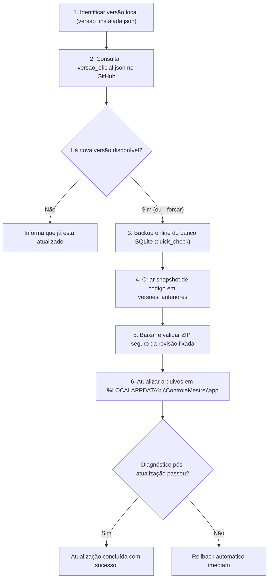

# CONTROLE MESTRE — PADRONIZAÇÃO DEFINITIVA DA INSTALAÇÃO E ATUALIZAÇÃO

Este documento estabelece o padrão arquitetural definitivo para a instalação, atualização contínua e preservação de dados do **CONTROLE MESTRE** no Windows.

---

## 1. Princípios Fundamentais

1. **Fim da Proliferação de Pastas:**
   - O usuário utiliza exclusivamente a pasta `CONTROLE MESTRE` na Área de Trabalho.
   - Atualizações futuras ocorrem **no mesmo local** via atalho `ATUALIZAR_CONTROLE_MESTRE.bat`.
   - NUNCA mais é necessário baixar ZIPs manuais, descompactar arquivos na Área de Trabalho ou criar pastas como `ATUALIZADOR_CM_V7`, `V8`, etc.

2. **Separação Rígida entre Código e Dados:**
   - **Código do Aplicativo:** `%LOCALAPPDATA%\ControleMestre\app` (substituível em atualizações).
   - **Dados e Histórico:** `%LOCALAPPDATA%\ControleMestre\dados` (preservado permanentemente).
   - **Banco SQLite Ativo:** `%LOCALAPPDATA%\ControleMestre\dados\controle_mestre.db`.
   - **Backups Consistentes:** `%LOCALAPPDATA%\ControleMestre\dados\backups`.
   - **Pontos de Restauração de Código:** `%LOCALAPPDATA%\ControleMestre\versoes_anteriores`.

3. **Segurança Transacional e Integridade:**
   - Todo processo de atualização gera backup online do banco SQLite via `sqlite3.Connection.backup()` com verificação de integridade `PRAGMA quick_check` antes e depois da cópia.
   - Qualquer falha na extração, na validação de arquivos ou no teste de diagnóstico aciona **rollback automático e imediato** para o estado anterior.

4. **Origem Versionada e Validada (Sem Uso Cego da `main`):**
   - O atualizador não consome branches instáveis. Ele consulta o manifesto oficial `versao_oficial.json` no repositório, apontando para commits verificados por bateria de testes automatizados (CI).

---

## 2. Estrutura na Área de Trabalho do Usuário

Na Área de Trabalho do usuário, existe apenas a pasta:
`C:\Users\<Usuario>\Desktop\CONTROLE MESTRE`

Dentro dela, mantêm-se estritamente:
- `ABRIR_CONTROLE_MESTRE.bat` — Inicia a plataforma no navegador (porta 8771).
- `ATUALIZAR_CONTROLE_MESTRE.bat` — Executa o atualizador universal.
- `INSTRUCOES_DE_UTILIZACAO.txt` — Manual rápido de uso e suporte.
- `instaladores_antigos\` — Subpasta onde foram arquivadas as instalações antigas, com relatórios e bancos anteriores preservados.

---

## 3. Como Funciona o Atualizador Universal (`atualizador.py`)

O atualizador opera em 6 fases automatizadas:



### Comandos Disponíveis no Atualizador:
- `py -3 atualizador.py` — Atualização interativa padrão.
- `py -3 atualizador.py --verificar` — Apenas consulta se há atualização sem aplicar.
- `py -3 atualizador.py --forcar` — Reinstala/repara os arquivos mesmo se estiver na mesma versão.
- `py -3 atualizador.py --reverter` — Restaura o último ponto de restauração salvo em `versoes_anteriores`.
- `py -3 atualizador.py --arquivar` — Arquiva diretórios legados do Desktop em `instaladores_antigos`.
- `py -3 atualizador.py --diagnostico` — Exibe dados de integridade, banco e caminhos ativos.

---

## 4. Como Publicar Novas Atualizações no Repositório

Quando uma nova versão do CONTROLE MESTRE estiver pronta para ser disponibilizada aos usuários:

1. **Desenvolvimento e Testes:**
   - Faça as alterações na branch correspondente (ex: `feat/...` ou `release/...`).
   - Execute os testes no terminal:
     ```powershell
     py -3 -m unittest discover tests
     ```
   - Certifique-se de que todos os testes passaram (ex: 228 testes OK).

2. **Commit e Push:**
   - Faça commit das alterações e envie para o GitHub:
     ```powershell
     git add .
     git commit -m "feat: melhorias da versao 0.8.7"
     git push origin <sua-branch>
     ```
   - Obtenha o hash completo do commit gerado (ex: `a1b2c3d4...`).

3. **Atualização do Manifesto Oficial (`versao_oficial.json`):**
   - Atualize o arquivo `versao_oficial.json` no repositório apontando para a nova revisão:
     ```json
     {
       "produto": "CONTROLE MESTRE",
       "versao": "0.8.7",
       "revisao": "<hash_completo_do_commit>",
       "branch_origem": "<sua-branch>",
       "data_publicacao": "2026-11-09",
       "status": "consolidada",
       "descricao": "Notas da versão 0.8.7",
       "archive_url": "https://api.github.com/repos/antoniomoraes85/Controle-Mestre/zipball/<hash_completo_do_commit>",
       "arquivos_obrigatorios": [ ... ]
     }
     ```
   - Faça commit e push do `versao_oficial.json`.

4. **Resultado para o Usuário Final:**
   - O usuário simplesmente clica duas vezes no atalho `ATUALIZAR_CONTROLE_MESTRE.bat` na Área de Trabalho.
   - O atualizador detecta a nova versão, realiza o backup seguro do banco, atualiza o código na mesma pasta e informa o sucesso.
   - Zero trabalho manual de descompactação, zero arquivos duplicados e zero risco de perda de histórico.
