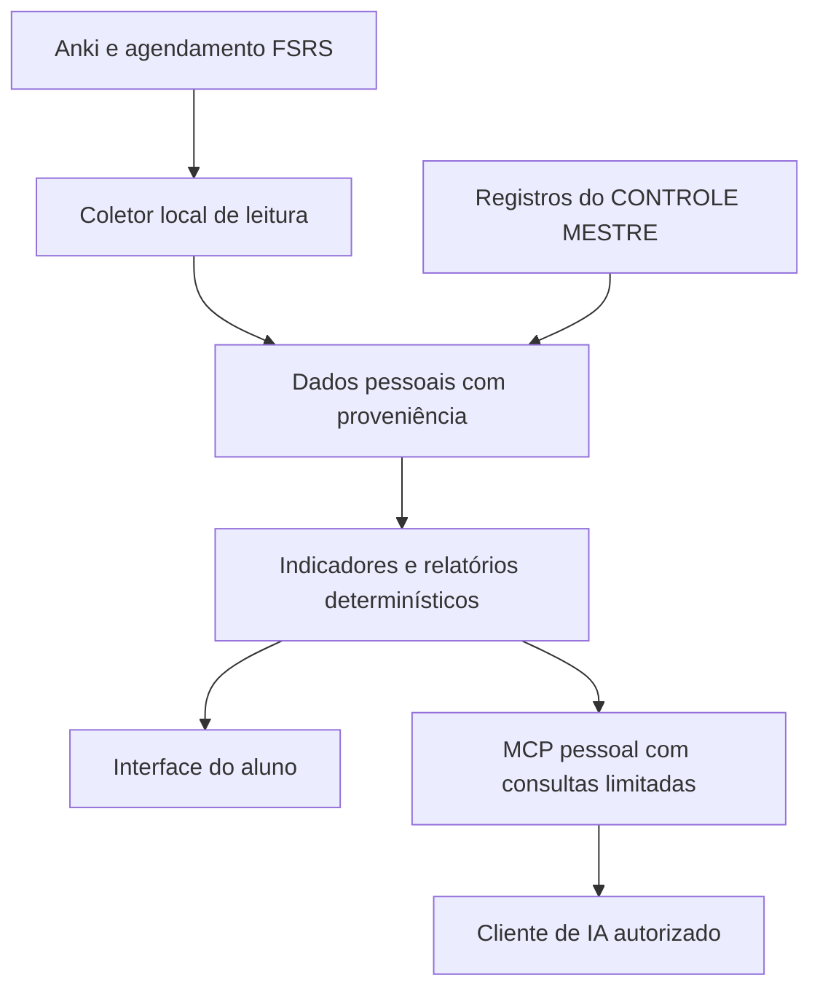

# CONTROLE MESTRE — Pesquisa 03/08: Guruja Arena, IA e MCP

**Data:** 07/11/2026. **Resultado:** pesquisa documental entregue, com verificação parcial do vídeo e ausência de especificação pública de MCP da Guruja nas fontes localizadas. **Escopo:** flashcards, integração de dados e relatórios. Nenhuma implementação ou alteração de issues integra esta entrega.

Foram consultadas as pesquisas [01 — Planejamento](01_GURUJA_PLANEJAMENTO.md) e [02 — Reforços inteligentes](02_GURUJA_REFORCOS_INTELIGENTES.md), além da estratégia existente de [Anki e evolução analítica](../ESTRATEGIA_ANKI_RL_MARCA.md). Este documento complementa essas bases; não redefine o planejamento nem os algoritmos pedagógicos da pesquisa 02.

## 1. Critérios de evidência e cobertura

- **Documentado pelo fornecedor:** fonte oficial descreve o recurso; não equivale a teste autenticado ou comprovação de eficácia.
- **Anunciado/em teste:** apresentação de uma entrega futura ou ainda em validação; não assumir disponibilidade geral.
- **Não verificado:** evidência insuficiente. Ausência de documentação localizada não comprova ausência da funcionalidade.
- **Proposta CM:** alternativa independente. Arquiteturas, regras e métricas abaixo não descrevem algoritmos internos da Guruja.

### 1.1 Vídeo principal: 34–41 minutos

Fonte V: [Black Friday 2026 | Guruja Concursos](https://www.youtube.com/watch?v=OOpSWIqsNvo&t=2040s). A descrição pública anuncia a transmissão de 06/11/2026 e contém os capítulos abaixo. Capítulo é evidência de localização, não prova do funcionamento de uma tela.

| Recorte | Evidência efetivamente disponível | Limite |
|---|---|---|
| 34:29–36:00 | A pesquisa 02, evidência E04, registra transcrição anteriormente recuperada: análises em teste, tendências entre quinzenas, interpretação dos erros e início do parecer de preparação pós-edital. | Evidência reaproveitada com rastreabilidade; não houve nova inspeção visual. |
| 34:32 | Capítulo “Minhas análises (diversos comparativos)” na descrição. | Não comprova lançamento para todos os alunos. |
| 36:41 | Capítulo de atenção ao sorteio. | Sem inferência funcional. |
| 37:55–41:00 | Capítulo “Arena (novidade Guruja)” começa em 37:55; o próximo capítulo inicia em 41:30. | Conteúdo falado e telas deste intervalo não foram recuperados nesta etapa. A análise funcional do Arena usa seu guia oficial. |

**Limitação técnica:** o serviço de transcrição já havia informado créditos insuficientes na pesquisa anterior. Nesta etapa, a página pública forneceu metadados, mas o retorno de legendas veio vazio e a tentativa de transcrição pública retornou erro HTTP 400. Não se afirma que o vídeo inteiro foi assistido. O vídeo complementar enviado pelo usuário, `f9_GFSmnVNM`, permanece registrado na pesquisa 02; não foi reanalisado nem usado para confirmar recursos novos.

## 2. Guruja Arena

### 2.1 Recursos documentados

Fonte: [guia oficial do Arena](https://guruja.com.br/arena/) [A]. Sem teste autenticado.

| Aspecto | Declaração oficial |
|---|---|
| Flashcards | Curadoria da equipe; pergunta/resposta, certo/errado e lacunas. |
| Revisão espaçada | FSRS declarado, referência de 90% de retenção; projeções didáticas. |
| Atividades e planejamento | Concluir Fixação Ativa insere cartões conforme resultados por assunto, comparação na disciplina e peso no edital. |
| Organização | Prateleira oferece coleções temáticas conforme o perfil. |
| Seleção | Presets Conservador, Equilibrado e Abrangente; automação desativável. Atacar Lacunas permite aceitar candidatos e excluir assuntos. |
| Carga | Cota semanal de inserção manual distinta dos 20 novos/dia; revisões não limitadas por essa cota diária. |
| Interoperabilidade | Sem importação/exportação de cartões, inclusive Anki. |

Fluxos: **atividade → cartões → revisão**; **assinar coleção → fila**; **lacunas → aceitar candidatos → fila**.

### 2.2 O que permanece desconhecido

Não foram confirmados versão e parâmetros do FSRS em produção, personalização por estudante, fórmula de seleção, critérios completos de desempate, valor da cota semanal, deduplicação entre entradas, histórico de alterações dos cartões ou diferenças entre planos de assinatura. A data de publicação/versão do guia não foi identificada; não se deve presumir que ele retrate exatamente a versão exibida no vídeo.

As simulações não demonstram aumento real de retenção, redução de tempo ou transferência para questões inéditas. Tampouco confirmam que a agenda de cartões respeite a disponibilidade diária do calendário estudado na pesquisa 01.

**Oportunidade para o CM:** conectar os cartões próprios do aluno ao diagnóstico por assunto, com rastreabilidade e controle da carga. A alternativa proposta não depende de importar conteúdo do Arena nem de reproduzir suas regras.

## 3. Integração MCP da Guruja

### 3.1 Resultado da investigação

Não foi localizada especificação oficial de um servidor MCP da Guruja nas páginas e buscas consultadas. O trecho ainda indisponível do vídeo não pode preencher essa lacuna. Portanto, **não há base suficiente nesta pesquisa para classificar MCP como disponível nem para confirmar um anúncio específico**.

| Objeto solicitado | Situação comprovável |
|---|---|
| Recursos declarados | Lista de ferramentas, recursos e prompts MCP não localizada. |
| Sistemas de IA compatíveis | Nenhuma matriz oficial confirmada. Menção genérica a assistentes em conteúdo educativo não comprova integração. |
| Dados acessíveis | Não verificados: metas, questões, erros, cartões, relatórios ou informações do orientador. |
| Consultas possíveis | Exemplos executáveis, parâmetros, paginação e limites não localizados. |
| Permissões | Escopos, leitura/escrita, autorização por aluno e revogação desconhecidos. |
| Operação | Endpoint, transporte, versão do protocolo, instalação, disponibilidade por plano e quotas desconhecidos. |
| Privacidade específica | Provedores de IA, dados enviados, retenção de conversas e uso para treinamento não esclarecidos por documentação MCP localizada. |

A [política de privacidade](https://guruja.com.br/politicas-de-privacidade/) [P], com atualização indicada em **07/10/2023**, descreve coleta cadastral/de navegação, armazenamento em nuvem, compartilhamento com parceiros e solicitações sobre dados pessoais. É uma política geral; não estabelece o contrato de autorização de um eventual MCP nem esclarece processamento por modelos de IA. Não se infere segurança ou insegurança de uma integração que não foi verificada.

**Hipóteses de investigação, não características da Guruja:** um eventual servidor poderia expor resumos pessoais ou permitir perguntas sobre evolução. Confirmar essas possibilidades exige documentação oficial, demonstração verificável ou acesso autorizado com dados de teste.

## 4. Relatórios inteligentes

| Recurso | Evidência e classificação | Limite relevante |
|---|---|---|
| Análises individuais | Vídeo, E04 da pesquisa 02: análises em teste. **Anunciado**, sem confirmação de lançamento geral. | Não se conhece estrutura final, frequência garantida ou modelo utilizado. |
| Comparação temporal | E04 descreve tendências entre quinzenas. | Normalização por quantidade/dificuldade, dados ausentes e critérios de melhora não conhecidos. |
| Comparação entre estudantes | Artigo oficial sobre lacunas [L] descreve comparação com participantes da mesma atividade, recortes por assunto e tratamento de outliers. **Documentado** para comparativos. | Não comprova que o novo relatório utilize exatamente a mesma população. Amostra e regra de exclusão não publicadas. |
| Diagnóstico de dificuldades | [L] sustenta leitura contextual do desempenho e acompanhamento; E04 anuncia interpretação dos erros. | Percentual inferior não identifica sozinho causa ou domínio. Não há demonstração de diagnóstico causal automatizado. |
| Recomendações geradas | E04 registra início do parecer para preparação pós-edital. **Anunciado/em teste** no trecho disponível. | Não se verificaram exemplos completos, fontes, validação pelo professor ou execução automática das recomendações. |

As fontes não permitem atribuir os relatórios a um LLM específico, RAG, modelo preditivo ou MCP. Texto personalizado pode resultar de regras, curadoria ou diferentes tecnologias; o mecanismo interno permanece desconhecido.

**Fluxo alternativo CM:** selecionar período e objetivo → conferir cobertura dos dados → calcular indicadores → apresentar evidências e incertezas → sugerir ações → aluno revisar → acompanhar resultados. A interpretação em linguagem natural é opcional; os cálculos devem continuar disponíveis sem IA.

## 5. O que o CONTROLE MESTRE já possui

Base de leitura: commit **`9dd4ed9de1b20da9594bf75b1ab035071232f657`**, anterior a esta entrega. Inspeção documental e de código, sem execução de testes.

| Base existente | Evidência | Lacuna para esta pesquisa |
|---|---|---|
| Importação Anki por CSV | `core.py`, função `import_anki_csv`: aceita agregados por baralho/dia, revisões, erros e tempo; mapeia disciplina pela raiz do baralho. [C1] | Não preserva identidade individual de cartão/revisão nem oferece diagnóstico por assunto automaticamente. |
| Controle de duplicatas | Impressão digital composta por hash do arquivo e número da linha. [C1] | Reimportar o mesmo arquivo é protegido; os mesmos eventos reorganizados em outro CSV podem ser contados novamente. |
| Separação de tempo | Aviso do importador mantém minutos do Anki separados do cronômetro. [C1] | Integração futura precisa conciliar sessões sobrepostas antes de somar carga. |
| Diagnóstico adaptativo | Pesquisa 02 documenta desempenho por disciplina/assunto e recomendações explicáveis, com limitações de granularidade. | Reutilizar o motor e os contratos propostos ali; não apresentar suas propostas como recursos já implementados. |
| Estratégia de integração | Documento existente propõe Anki inicialmente em leitura, IA opcional e MCP pessoal. [C2] | Diretriz não equivale a conector operacional. A inspeção realizada não confirmou AnkiConnect, servidor MCP ou integração ativa com FSRS. |

Não é possível reconstruir revisões individuais a partir dos agregados atuais. A migração deve conservar a origem e a resolução dos dados, sem fabricar IDs ou avaliações.

## 6. Arquitetura independente proposta

Todos os componentes a seguir são **propostas**, sem implementação nesta tarefa.

O Anki permanece responsável pelo agendamento dos cartões. O CM estima carga, relaciona evidências e explica recomendações. Não deve existir um segundo agendador concorrente escrevendo intervalos no mesmo cartão.

### 6.1 AnkiConnect: coleta mínima e incremental

O repositório original do AnkiConnect foi arquivado e aponta migração para o endereço mantido pelo autor [T1]. O código oficial arquivado contém `version`, `deckNamesAndIds`, `findCards`, `cardsInfo`, `notesInfo`, `cardReviews` e `getReviewsOfCards`; sua configuração usa endereço local, porta 8765 e chave inicialmente nula. Isso confirma uma superfície histórica, **não compatibilidade testada com a instalação futura do aluno**. O destino atual não pôde ser lido pelo leitor web; versão, assinatura e semântica de cada método deverão ser verificadas antes de desenvolver.

Proposta de fluxo:

1. Aluno seleciona perfil e baralhos autorizados; coletor verifica versão/capacidades e recusa uma configuração incompatível.
2. Importa IDs e metadados mínimos; conteúdo de frente/verso permanece excluído por padrão. Se uma chamada retornar campos extras, o coletor os descarta antes de persistir ou transmitir.
3. Associa cartões a assuntos por mapeamento explícito de tags/baralhos, versionado e revisável. Cartões sem vínculo ficam como não classificados.
4. Coleta revisões em lotes, com cursor e janela de sobreposição. A chave proposta combina origem, identidade estável da coleção/perfil e ID externo de revisão; guarda também o cartão relacionado.
5. Faz atualização idempotente e concilia correções, desfazer e exclusões quando a API permitir. Ausência de evento em consulta incompleta não significa exclusão.
6. Persiste cursor apenas após gravar o lote; detecta troca/restauração da coleção e exige reconciliação, evitando misturar perfis ou perder eventos anteriores ao cursor.
7. Quando o Anki estiver fechado, mostra o último retrato com data e estado desatualizado. Ausência de sincronização nunca vira zero revisões.

Se não houver identidade externa estável ou acesso suficiente, manter importação agregada identificada como tal. O AnkiConnect permite ações além de leitura: a restrição precisa ser imposta pelo adaptador do CM, com lista fechada de métodos, e não apenas pelo prompt da IA. Não expor encaminhamento genérico de ações.

### 6.2 FSRS, seleção de cartões e carga

A documentação do Anki [T2] relaciona retenção desejada e carga de revisões, orienta otimização pelo histórico e distingue esquecimento de recordação difícil. Sua utilização deve respeitar a versão instalada e a qualidade das avaliações do aluno. Não copiar parâmetros de terceiros nem tratar `Hard` como esquecimento.

Alternativa proposta:

- Ler vencimentos e histórico disponíveis; consumir estados específicos do FSRS somente se houver acesso documentado e compatível. Não supor que o AnkiConnect exponha todos os campos internos.
- Estimar minutos de revisão a partir da quantidade prevista e mediana recente de tempo por tipo de cartão; mostrar faixa de incerteza e erro histórico da estimativa.
- Reservar no planejamento um bloco de revisão com esse custo, sinalizando excedentes. Preservar intervalos do Anki; não responder, suspender ou reagendar cartões automaticamente para fazer o calendário caber.
- Para lacunas identificadas pelo motor da pesquisa 02, sugerir cartões próprios já vinculados ao assunto. Na falta deles, propor um rascunho com fonte e revisão humana; criação/escrita fica fora da primeira integração.
- Usar orçamento configurável de tempo e propostas de novos cartões. Não adotar o limite do concorrente como regra universal nem alterar silenciosamente os limites do Anki.

Recordar um cartão é uma evidência de memória naquele contexto; não equivale a dominar todo o assunto, acertar questão inédita ou ter determinada probabilidade de aprovação. `Again` e erros em questões devem manter indicadores separados.

### 6.3 Consulta por IA e servidor MCP pessoal

Para um cliente local que suporte lançamento de processos, iniciar por **stdio**, com identidade vinculada ao perfil autorizado. Para acesso remoto futuro, avaliar **Streamable HTTP**, autenticação obrigatória no produto e limites de acesso. A especificação MCP consultada, revisão **2026-07-28**, documenta ambos os transportes [T3]. Fixar versões compatíveis de SDK/cliente e testar interoperabilidade; não presumir compatibilidade apenas pelo nome do assistente.

Um modelo de IA não é, sozinho, um cliente MCP. A aplicação que o utiliza precisa suportar o transporte, a versão e o fluxo de autorização. Um serviço em nuvem não acessa automaticamente o `localhost` do computador do aluno; disponibilização remota requer arquitetura própria. A porta do AnkiConnect não deve ser publicada.

Contrato de consultas proposto — nomes abaixo pertencem ao CM, não à Guruja:

| Ferramenta | Entrada permitida | Saída mínima |
|---|---|---|
| `get_study_summary` | Período limitado e filtros de disciplina | Tempo por origem, volume, cobertura e atualização. |
| `get_topic_evidence` | ID de assunto pertencente ao perfil | Indicadores separados, amostras e referências de evidências. |
| `get_review_backlog` | Horizonte limitado | Vencidos, previsão disponível e estimativa de tempo. |
| `compare_periods` | Dois períodos e filtros comuns | Variações, denominadores e ressalvas de comparabilidade. |
| `get_report` | ID de relatório autorizado | Retrato versionado, recomendações e fontes internas. |

O usuário efetivo é derivado da sessão/autorização, nunca de um `user_id` livre escolhido pelo modelo. Respostas devem incluir período, fuso, data da coleta, completude, versão dos cálculos e IDs de evidência. Não expor SQL arbitrário, caminhos de arquivos, execução de shell ou uma ferramenta genérica de escrita.

A IA explica resultados já calculados e diferencia observação de hipótese. Recomendações ficam como propostas, sem alterar metas ou cartões. Um servidor local pode entregar dados a um modelo remoto: **localidade do MCP não garante que os dados permaneçam no computador**. A escolha do provedor e do conteúdo enviado deve ser explícita.

### 6.4 Relatórios inteligentes verificáveis

Proposta de relatório inicial, utilizável sem IA:

1. **Cobertura:** fontes disponíveis, atraso de sincronização, assuntos sem classificação e períodos incompletos.
2. **Execução:** tempo por origem, metas realizadas e revisões, sem dupla contagem.
3. **Evolução:** comparar janelas de mesma duração/fuso, preservando filtros de assunto, banca e modalidade. Mostrar contagem e variação em pontos percentuais, não apenas percentuais relativos.
4. **Dificuldades:** separar lapsos em cartões, erros em questões e causas relatadas. Usar o diagnóstico da pesquisa 02, com amostra e incerteza visíveis.
5. **Ações:** poucas recomendações explicadas por evidências, custo estimado e critério de acompanhamento.
6. **Resultado posterior:** vincular intervenção a retestes e retenção conforme a pesquisa 02; marcar falta de acompanhamento e mudanças na composição dos itens.

Mudança no desempenho pode refletir dificuldade diferente ou itens já vistos. O relatório deve explicar essas limitações, sem alegar efeito causal do reforço. Texto gerado precisa citar evidências internas e permitir reproduzir números; sem suporte, responder que não há dados suficientes.

**Comparação entre estudantes:** não necessária para o primeiro produto pessoal. Comparar o aluno consigo mesmo e com objetivos explícitos. Não obter dados de terceiros nem inventar média de turma. Uma extensão futura dependeria de base autorizada, grupos comparáveis, proteção contra reidentificação e política própria; não é requisito para entregar valor agora.

### 6.5 Preparação para modelos preditivos

Estender os registros propostos na pesquisa 02 com origem, instante do evento e da coleta, versão do mapeamento, recomendação apresentada, aceitação, carga prevista e resultado posterior. Preservar o que estava disponível no momento da decisão para evitar vazamento temporal.

Primeiros objetivos possíveis: estimar tempo de revisão e identificar risco de acúmulo. Começar com medianas/regras transparentes; comparar modelo supervisionado em modo de observação, sem mudar o plano. Avaliar MAE para tempo, calibração/Brier para eventos binários bem definidos e desempenho por faixa de histórico, sempre em separação temporal.

Modelos devem superar a referência simples fora da amostra, ter tratamento para início sem histórico e tolerar mudanças de rotina. Não usar retenção prevista como chance de aprovação. Aprendizado por reforço permanece posterior: registros observacionais, isoladamente, não demonstram qual ação alternativa teria produzido melhor resultado.

## 7. Segurança e controle de acesso propostos

| Risco | Controle mínimo do CM |
|---|---|
| Acesso indevido ao Anki | Comunicação local, chave configurada quando suportada, origens restritas e lista de leitura no adaptador; nenhum encaminhamento genérico. |
| Mistura de perfis | Autorização e armazenamento por identidade da coleção; abortar coleta se o perfil mudar durante o lote. |
| Exposição a modelo externo | Mostrar categorias de dados enviadas; agregados por padrão; conteúdo de cartões e anotações exige escolha específica. |
| Instruções maliciosas em cartões/notas | Tratar textos como dados não confiáveis; não permitir que alterem permissões, ferramentas ou destino de envio. |
| Vazamento apesar de somente leitura | Limitar campos, linhas, períodos e taxa de chamadas; proteger exportações e registrar acessos sem conteúdo sensível. |
| Credenciais expostas | Segredos fora do Git e dos prompts; armazenamento apropriado ao ambiente; revogação e rotação. |
| Acesso HTTP remoto | HTTPS, validação de origem e token, audiência/recurso e escopos mínimos; não aceitar token destinado a outro serviço. |
| Dados persistidos indevidamente | Política explícita de retenção, exclusão de cache e revogação; revogar não apaga automaticamente cópias já enviadas a terceiros. |

A especificação de autorização MCP para HTTP e suas práticas de segurança [T4–T5] fundamentam a opção remota. Autenticar não autoriza acesso irrestrito: cada consulta deve aplicar o perfil e os escopos. A revisão de segurança deverá acompanhar a versão efetivamente implementada. Estas são exigências propostas de engenharia, não atestado de conformidade jurídica nem avaliação técnica do ambiente privado da Guruja.

## 8. Dependências, complexidade e prioridades

Complexidade relativa, sem estimativa de prazo ou compromisso de implementação. P0 precede P1; P2 depende de validação e necessidade demonstrada.

| Prioridade | Entrega futura | Dependências | Complexidade / risco principal |
|---|---|---|---|
| P0 | Identidade, proveniência e classificação por assunto | Contratos da pesquisa 02; distinção entre agregados e eventos | Média / duplicação e migração incorreta. |
| P0 | AnkiConnect somente leitura | Anki aberto, complemento compatível, autorização por perfil | Média / diferenças de versão, restauração e coleta incompleta. |
| P0 | Relatório determinístico pessoal | Dados conciliados, filtros e indicadores versionados | Média / comparações enganosas. |
| P1 | Carga de revisão no planejamento | Histórico de tempo, vencimentos e disponibilidade da pesquisa 01 | Média / previsão imprecisa e dupla contagem. |
| P1 | MCP local com consultas restritas | Serviço de leitura, cliente compatível e isolamento de perfil | Média / exposição excessiva de dados. |
| P1 | Narrativa por IA opcional | Relatórios rastreáveis, política de envio e orçamento de uso | Média / alucinação, custo e privacidade. |
| P2 | MCP remoto e escrita assistida, avaliados separadamente | Autenticação, consentimento por ação e recuperação de erros | Alta / ampliação da superfície de acesso e alterações indevidas. |
| P2 | Predição supervisionada em observação | Histórico suficiente, desfechos confiáveis e avaliação temporal | Alta / sobreajuste e ausência de ganho útil. |

**Ordem recomendada:** qualidade dos dados → relatório conferível → leitura local → IA opcional. A coleta Anki pode evoluir junto à base de dados; MCP não deve anteceder a definição dos dados que poderá expor. Não é necessário criar um editor de flashcards ou um novo agendador para iniciar.

## 9. Requisitos sugeridos e critérios de aceitação

| ID | Requisito funcional ou de segurança | Aceitação e métrica |
|---|---|---|
| R03-01 | Importação idempotente por evento quando houver identidade estável | Repetir lotes e sobrepor períodos não altera totais; medir duplicatas e cobertura. |
| R03-02 | Preservar granularidade e origem | CSV agregado nunca aparece como tentativa individual; todos os indicadores informam origem. |
| R03-03 | Mapear cartões a assuntos com revisão | Mostrar não classificados e histórico de correções; medir cobertura e concordância em amostra. |
| R03-04 | Manter FSRS sob controle do Anki | Coletor não altera intervalos, respostas ou parâmetros; verificar ausência de chamadas de escrita. |
| R03-05 | Exibir frescor e completude | Anki indisponível resulta em dado desatualizado explícito; medir atraso de sincronização. |
| R03-06 | Estimar carga sem duplicar sessões | Conciliar amostra com registros originais; medir MAE dos minutos previstos. |
| R03-07 | Produzir comparação temporal reproduzível | Mesma versão e retrato geram os mesmos números; mostrar amostras, filtros e períodos incompletos. |
| R03-08 | Restringir MCP ao perfil autorizado | Consulta de outro perfil, período excessivo ou ferramenta não permitida é recusada. |
| R03-09 | Fundamentar recomendações da IA | Cada recomendação aponta evidência ou hipótese explícita; medir afirmações sem suporte em amostra revisada. |
| R03-10 | Controlar envio e revogação | Sem opção por provedor externo, não transmitir dados a ele; revogação bloqueia novas consultas. |
| R03-11 | Medir benefício posterior | Acompanhar retenção/questões inéditas e tempo, conforme pesquisa 02; não usar adesão como substituto de aprendizagem. |
| R03-12 | Validar modelos antes de interferir | Comparação temporal com referência simples e registro dos resultados negativos; manter alternativa determinística. |

Os IDs são referências deste documento. Não foram abertas nem atualizadas issues.

## 10. Dúvidas e investigação posterior

1. Recuperar fala e telas de 36:00–41:00, especialmente o Arena em 37:55; confirmar se existe anúncio MCP e localizar seu timestamp exato.
2. Confirmar versão, disponibilidade e condições de acesso ao Arena e aos relatórios; conciliar guia atual com a demonstração de novembro de 2026.
3. Obter documentação oficial de MCP, se existir: endpoint, clientes homologados, ferramentas, campos, autenticação, escopos, limites e revogação.
4. Esclarecer eventual envio a provedores de IA, retenção e exclusão; a política geral consultada não responde especificamente a isso.
5. Verificar FSRS efetivo do Arena, parâmetros configuráveis, quotas e seleção; não inferir regras de produção apenas dos simuladores.
6. Confirmar na versão de AnkiConnect escolhida acesso a revisões, identidade de coleção, correções/desfazer e campos de agendamento. Não pressupor suporte uniforme.
7. Definir quais dados pessoais o aluno aceita disponibilizar ao cliente de IA e como operar quando a coleta estiver indisponível.

Essas pendências não autorizam expansão desta entrega. Não houve benchmark adicional, implementação, novo plano diretor ou avanço para a pesquisa 04.

## 11. Fontes e rastreabilidade

Consultadas em 07/11/2026. Fontes técnicas abaixo servem exclusivamente às alternativas solicitadas; não constituem pesquisa comparativa de plataformas.

| ID | Fonte primária | Uso e ressalva |
|---|---|---|
| V | [Vídeo principal, 34:00](https://www.youtube.com/watch?v=OOpSWIqsNvo&t=2040s); [Arena, 37:55](https://www.youtube.com/watch?v=OOpSWIqsNvo&t=2275s) | Metadados/capítulos públicos; evidência parcial de transcrição preservada na pesquisa 02. |
| A | [Guruja Arena — guia interativo](https://guruja.com.br/arena/) | Funcionamento declarado e FAQ; sem teste autenticado, data/versão não identificadas. |
| L | [Como a Guruja identifica as lacunas de estudo?](https://guruja.com.br/como-a-guruja-identifica-as-lacunas-de-estudo/) | Comparativos e contexto, já analisados na pesquisa 02; não comprova lançamento dos novos relatórios. |
| P | [Política de privacidade Guruja](https://guruja.com.br/politicas-de-privacidade/) | Política geral, atualização exibida em 07/10/2023. |
| C1 | [core.py na base inspecionada](https://github.com/antoniomoraes85/Controle-Mestre/blob/9dd4ed9de1b20da9594bf75b1ab035071232f657/core.py) | `import_anki_csv`, linhas 402 em diante. |
| C2 | [Estratégia Anki/RL existente](https://github.com/antoniomoraes85/Controle-Mestre/blob/9dd4ed9de1b20da9594bf75b1ab035071232f657/docs/ESTRATEGIA_ANKI_RL_MARCA.md) | Compatibilização com diretrizes já registradas. |
| T1 | [AnkiConnect: repositório original](https://github.com/FooSoft/anki-connect), [código do complemento](https://github.com/FooSoft/anki-connect/blob/master/plugin/__init__.py), [configuração](https://github.com/FooSoft/anki-connect/blob/master/plugin/config.json) | Fonte oficial arquivada em 04/11/2025; README aponta [novo endereço do autor](https://git.sr.ht/~foosoft/anki-connect), cujo conteúdo não foi verificado. |
| T2 | [Manual Anki: opções de baralho/FSRS](https://docs.ankiweb.net/manual/deck-options) | Retenção desejada, histórico e avaliações. |
| T3 | [MCP 2026-07-28: transportes](https://modelcontextprotocol.io/specification/2026-07-28/basic/transports) e [Streamable HTTP](https://modelcontextprotocol.io/specification/2026-07-28/basic/transports/streamable-http) | Arquitetura local/remota e compatibilidade de versão. |
| T4 | [MCP 2026-07-28: autorização](https://modelcontextprotocol.io/specification/2026-07-28/basic/authorization) | Autorização para alternativa HTTP. |
| T5 | [MCP 2026-07-28: práticas de segurança](https://modelcontextprotocol.io/specification/2026-07-28/basic/security_best_practices) | Isolamento, tokens e riscos de integração. |

**Entrega restrita:** somente `docs/pesquisa/03_GURUJA_ARENA_IA_MCP.md`. Código, pesquisas anteriores e as 44 issues não foram alterados.
